<p align="center">
  <a href="https://chartjs.blazorexpress.com">
    
  </a>
</p>

<h3 align="center">BlazorExpress.ChartJS component library</h3>
<p align="center">
    An open-source, production-ready Blazor charts component library built on the <b>Blazor</b> and <b>Chart.js</b> JavaScript library.
    <br>
    <a href="https://chartjs.blazorexpress.com/docs/getting-started/introduction"><strong>Getting Started →</strong></a>
    <br>
</p>

## Status

[](https://www.nuget.org/packages/BlazorExpress.ChartJS/absoluteLatest)
[](https://www.nuget.org/packages/BlazorExpress.ChartJS/absoluteLatest)

## Table of contents

- [Quick start](#quick-start)
- [Online Demos](#online-demos)
- [Supported Tech Stack](#supported-tech-stack)
- [Components](#components)
- [Screenshots](#screenshots)
- [Creators](#creators)
- [Copyright and license](#copyright-and-license)

## Quick start

Get started any way you want

- Clone the repo: `git clone https://github.com/BlazorExpress/BlazorExpress.ChartJS`
- Install with the .NET CLI: `dotnet add package BlazorExpress.ChartJS --version 2.0.0`
- Or with the [NuGet](https://www.nuget.org/) Package Manager Console: `Install-Package BlazorExpress.ChartJS -Version 2.0.0`
- Upgrading from 1.x? 2.0.0 changes some defaults and behaviour, so read the [2.0.0 release notes](CHANGELOG.md#200) first.

Then draw your first chart:

1. Add the scripts to `wwwroot/index.html` (Blazor WebAssembly) or `Components/App.razor` (Blazor Web App), after Blazor's own script (`_framework/blazor.webassembly.js` or `_framework/blazor.web.js`):

    ```html
    <!-- Add a reference to Chart.js. -->
    <script src="https://cdnjs.cloudflare.com/ajax/libs/Chart.js/4.6.1/chart.umd.js" integrity="sha512-Vj/VnWZpOof68AJOIBxA90+7KQccA7eISngKbl18q5MQO3KnvO1a0z76Q+7hj8+iDIwETpKUBPN+cLy7PxvTEQ==" crossorigin="anonymous" referrerpolicy="no-referrer"></script>
    <!-- Add a reference to chartjs-plugin-datalabels.min.js if your application uses chart components with the data labels feature. -->
    <script src="https://cdnjs.cloudflare.com/ajax/libs/chartjs-plugin-datalabels/2.2.0/chartjs-plugin-datalabels.min.js" integrity="sha512-JPcRR8yFa8mmCsfrw4TNte1ZvF1e3+1SdGMslZvmrzDYxS69J7J49vkFL8u6u8PlPJK+H3voElBtUCzaXj+6ig==" crossorigin="anonymous" referrerpolicy="no-referrer"></script>
    <!-- Add a reference to blazorexpress.chartjs.js. -->
    <script src="_content/BlazorExpress.ChartJS/blazorexpress.chartjs.js"></script>
    ```

2. Add the namespace to `_Imports.razor`:

    ```razor
    @using BlazorExpress.ChartJS
    ```

3. Add a chart to a page. In a Blazor Web App, the page needs an interactive render mode, for example `@rendermode InteractiveServer` at the top of the page; without one the page renders as static HTML and the chart is not drawn.

<!-- quick-start:begin -->
```razor
<BarChart @ref="barChart" role="img" aria-label="Bar chart: units sold per month" Width="600" />

@code {
    private BarChart barChart = default!;

    protected override async Task OnAfterRenderAsync(bool firstRender)
    {
        if (!firstRender)
            return;

        var data = new ChartData
        {
            Labels = new List<string> { "January", "February", "March", "April" },
            Datasets = new List<IChartDataset>
            {
                new BarChartDataset
                {
                    Label = "Units sold",
                    Data = new List<double?> { 120, 150, 180, 140 },
                    BackgroundColor = new List<string> { "rgb(81, 43, 212)" },
                },
            },
        };

        await barChart.InitializeAsync(data, new BarChartOptions { Responsive = true });
    }
}
```
<!-- quick-start:end -->

The [getting started guide](https://chartjs.blazorexpress.com/docs/getting-started/introduction) covers installation for Blazor WebAssembly and Blazor Web App (Server), and the [samples](https://chartjs.blazorexpress.com/demos/samples) show every chart type and option.

## Online Demos

- [Demos Website](https://chartjs.blazorexpress.com)
- [Samples gallery](https://chartjs.blazorexpress.com/demos/samples): every sample with copyable source, searchable by chart, category and tag
- [Scenarios](https://chartjs.blazorexpress.com/demos/samples?category=scenarios): real-world tasks such as loading data from an API, live updates, dashboards, dark theme colours and large datasets

## Supported Tech Stack

| BlazorExpress.ChartJS | .NET | Chart.js | chartjs-plugin-datalabels |
|:--|:--|:--|:--|
| 2.0.0+ | 8, 9, 10, 11 | 4.6.1 | 2.2.0 |
| 1.2.2+ | 8, 9, 10 | 4.4.1 | 2.2.0 |
| 1.1.0+ | 8 | 4.4.1 | 2.2.0 |
| 1.0.0 | 8 | 4.0.1 | 2.2.0 |

## Components

| Component Name | Demos | Docs |
|:--|:--|:--|
| Charts: Bar chart | [Demos](https://chartjs.blazorexpress.com/demos/bar-chart) | [Docs](https://chartjs.blazorexpress.com/docs/bar-chart) |
| Charts: Bubble chart | [Demos](https://chartjs.blazorexpress.com/demos/bubble-chart) | [Docs](https://chartjs.blazorexpress.com/docs/bubble-chart) |
| Charts: Doughnut chart | [Demos](https://chartjs.blazorexpress.com/demos/doughnut-chart) | [Docs](https://chartjs.blazorexpress.com/docs/doughnut-chart) |
| Charts: Line chart | [Demos](https://chartjs.blazorexpress.com/demos/line-chart) | [Docs](https://chartjs.blazorexpress.com/docs/line-chart) |
| Charts: Pie chart | [Demos](https://chartjs.blazorexpress.com/demos/pie-chart) | [Docs](https://chartjs.blazorexpress.com/docs/pie-chart) |
| Charts: Polar area chart | [Demos](https://chartjs.blazorexpress.com/demos/polar-area-chart) | [Docs](https://chartjs.blazorexpress.com/docs/polar-area-chart) |
| Charts: Radar chart | [Demos](https://chartjs.blazorexpress.com/demos/radar-chart) | [Docs](https://chartjs.blazorexpress.com/docs/radar-chart) |
| Charts: Scatter chart | [Demos](https://chartjs.blazorexpress.com/demos/scatter-chart) | [Docs](https://chartjs.blazorexpress.com/docs/scatter-chart) |

## Screenshots

Captured from the [online demos](https://chartjs.blazorexpress.com/demos/samples); each image links to the sample it shows.

### Chart types

#### Bar chart

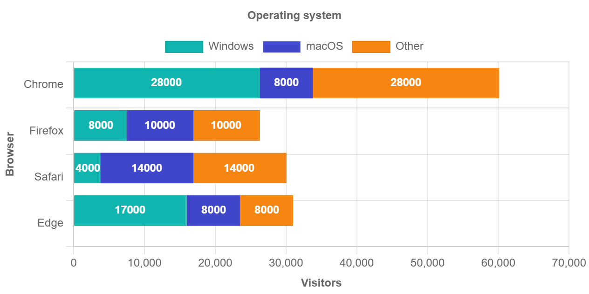

[Open the sample](https://chartjs.blazorexpress.com/demos/bar-chart/stacked-bar-chart-with-data-labels)

#### Bubble chart

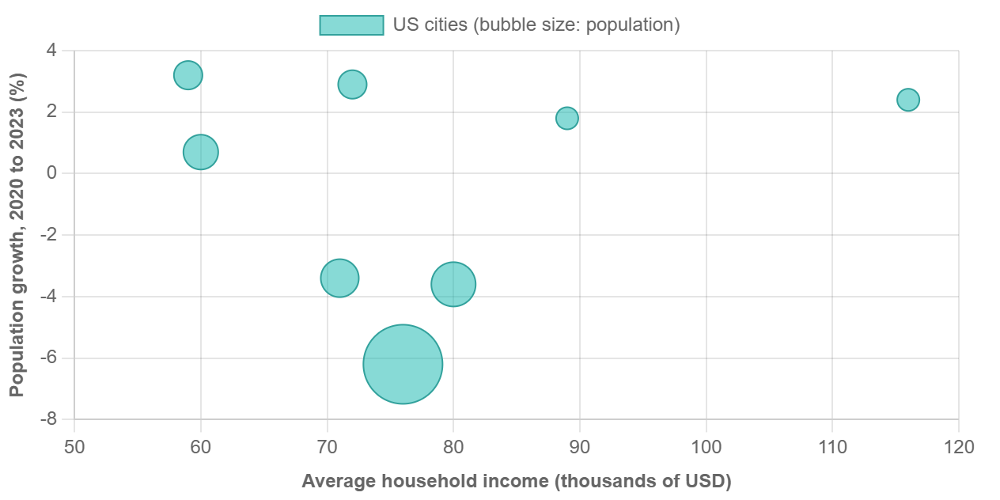

[Open the sample](https://chartjs.blazorexpress.com/demos/bubble-chart/how-it-works)

#### Doughnut chart

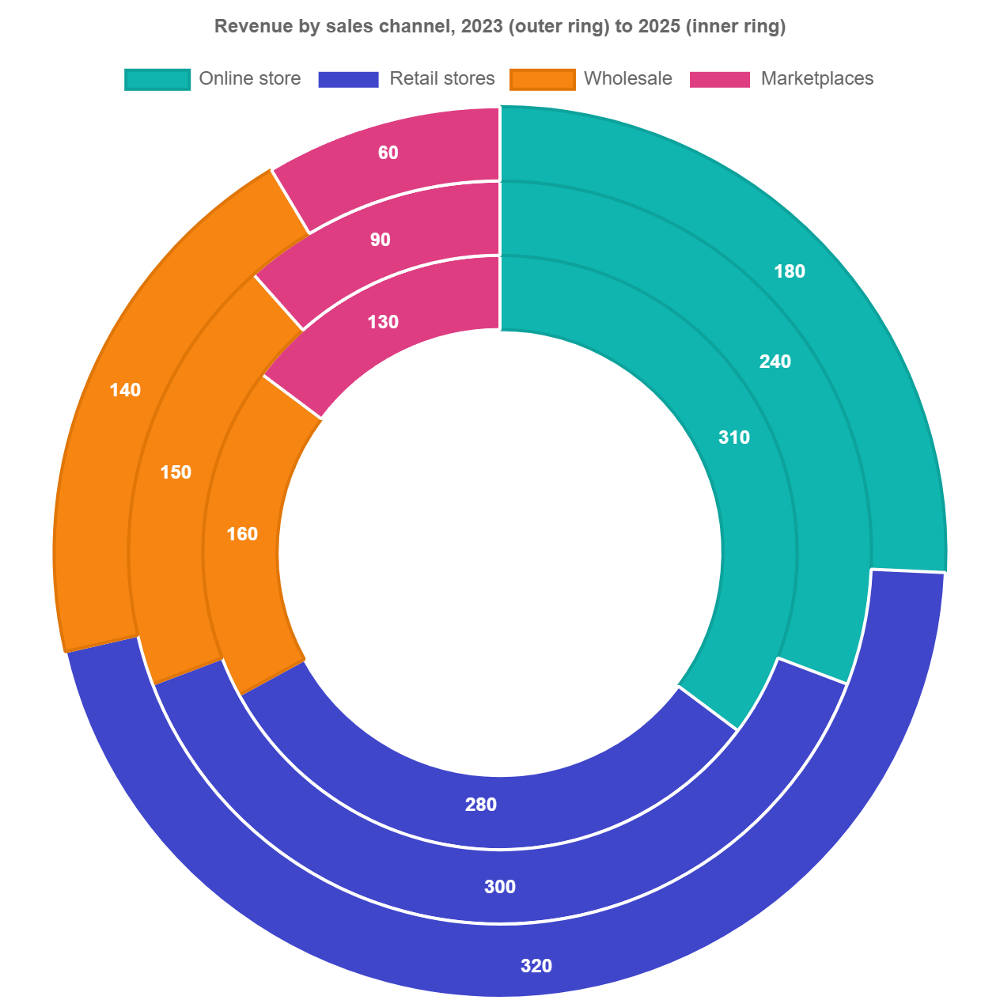

[Open the sample](https://chartjs.blazorexpress.com/demos/doughnut-chart/data-labels)

#### Line chart

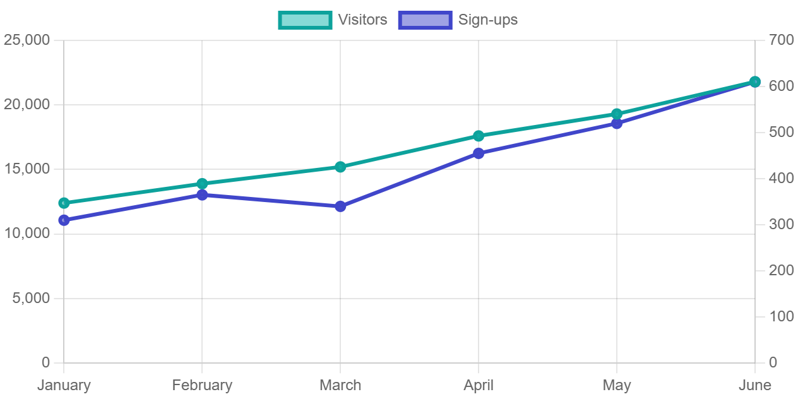

[Open the sample](https://chartjs.blazorexpress.com/demos/line-chart/how-it-works)

#### Pie chart

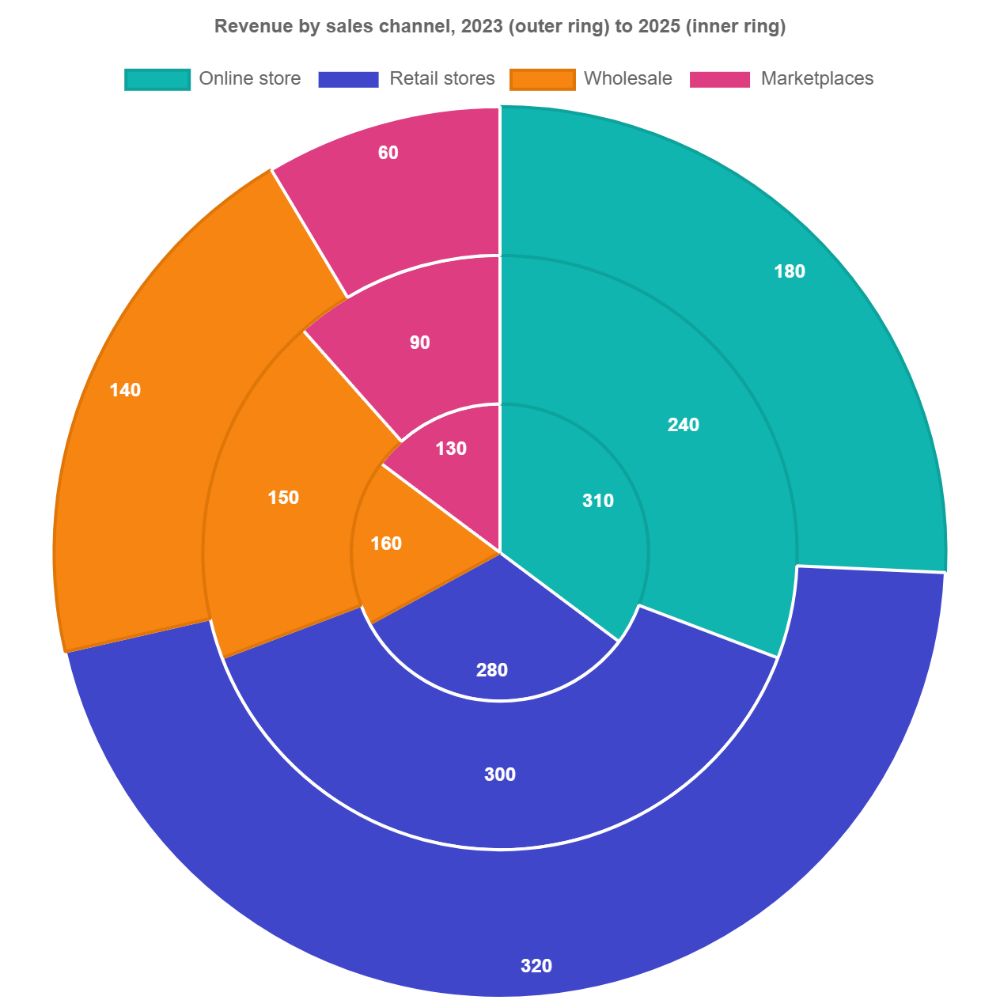

[Open the sample](https://chartjs.blazorexpress.com/demos/pie-chart/data-labels)

#### Polar area chart

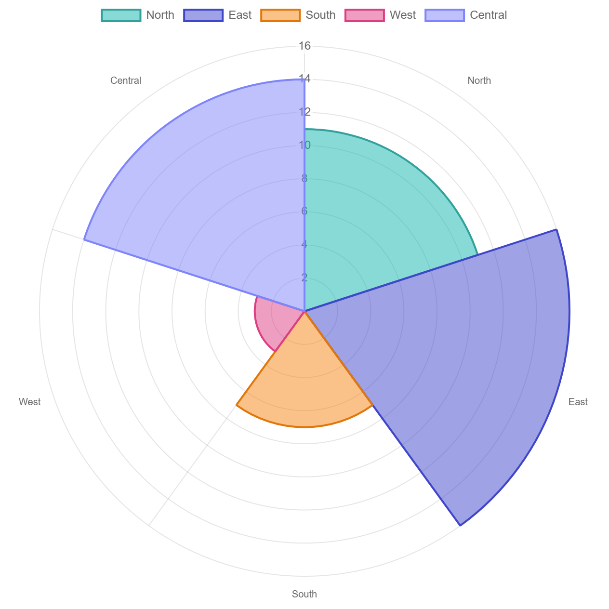

[Open the sample](https://chartjs.blazorexpress.com/demos/polar-area-chart/angle-lines-and-point-labels)

#### Radar chart

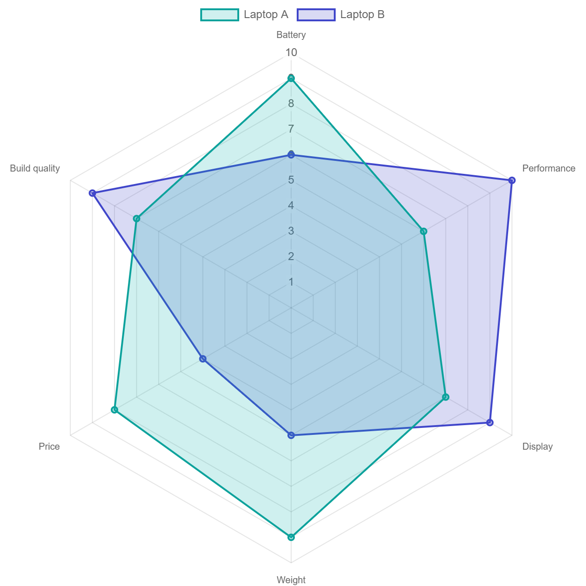

[Open the sample](https://chartjs.blazorexpress.com/demos/radar-chart/how-it-works)

#### Scatter chart

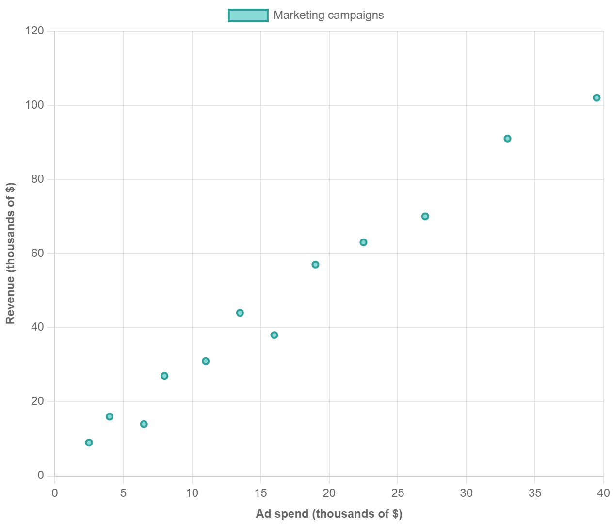

[Open the sample](https://chartjs.blazorexpress.com/demos/scatter-chart/how-it-works)

### New in 2.0.0

#### Time series

Line chart on a `timeseries` axis with dates from C#; no date adapter script needed.

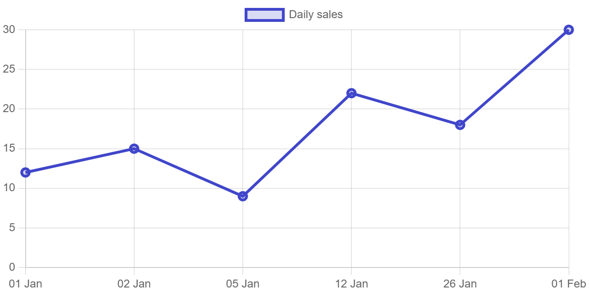

[Open the sample](https://chartjs.blazorexpress.com/demos/line-chart/time-series)

#### Tick and tooltip functions

Axis ticks and tooltip text formatted by JavaScript functions registered by name and set from C#.

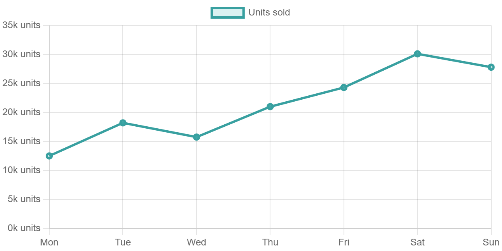

[Open the sample](https://chartjs.blazorexpress.com/demos/line-chart/tick-and-tooltip-functions)

#### Floating bars

A project schedule drawn with floating bars, each with a start and an end value (`BarChartDataset.FloatingData`).

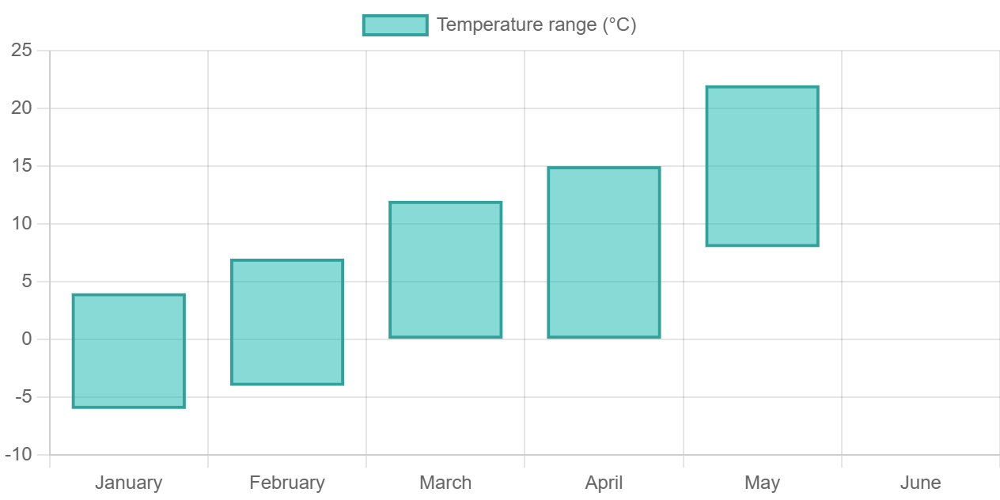

[Open the sample](https://chartjs.blazorexpress.com/demos/bar-chart/floating-bars)

#### Half gauge

A half-doughnut gauge from `Rotation` and `Circumference`.

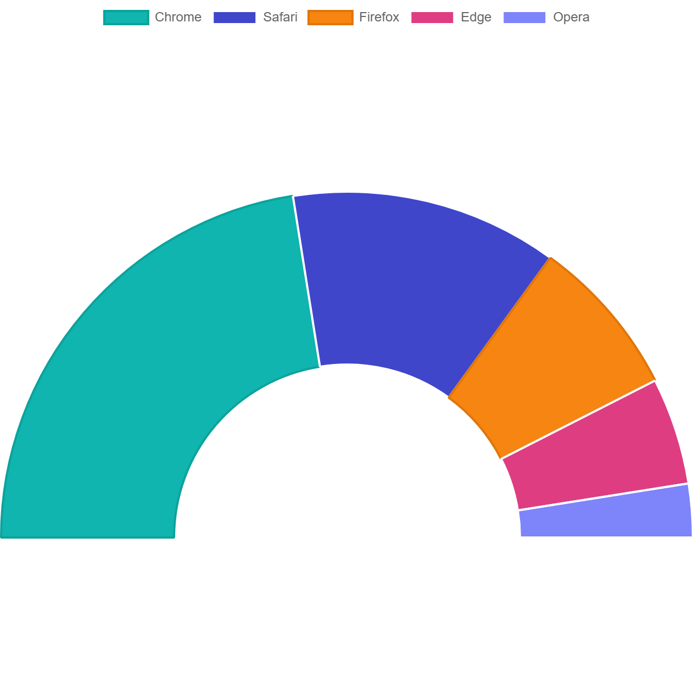

[Open the sample](https://chartjs.blazorexpress.com/demos/doughnut-chart/half-gauge)

#### Gradient fill

A line area filled with a gradient set by a JavaScript function.

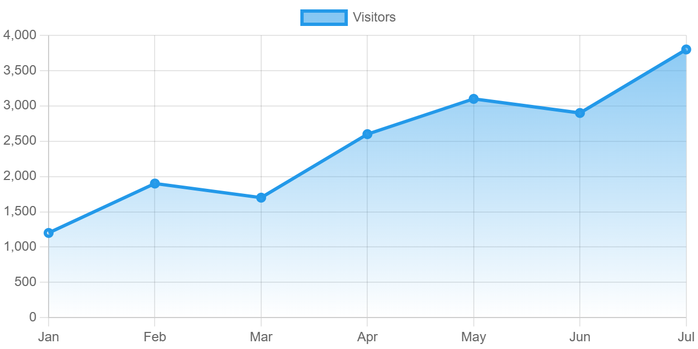

[Open the sample](https://chartjs.blazorexpress.com/demos/line-chart/gradient-fill)

#### Multiple axes

A second y axis on the right (`Scales.AdditionalAxes`).

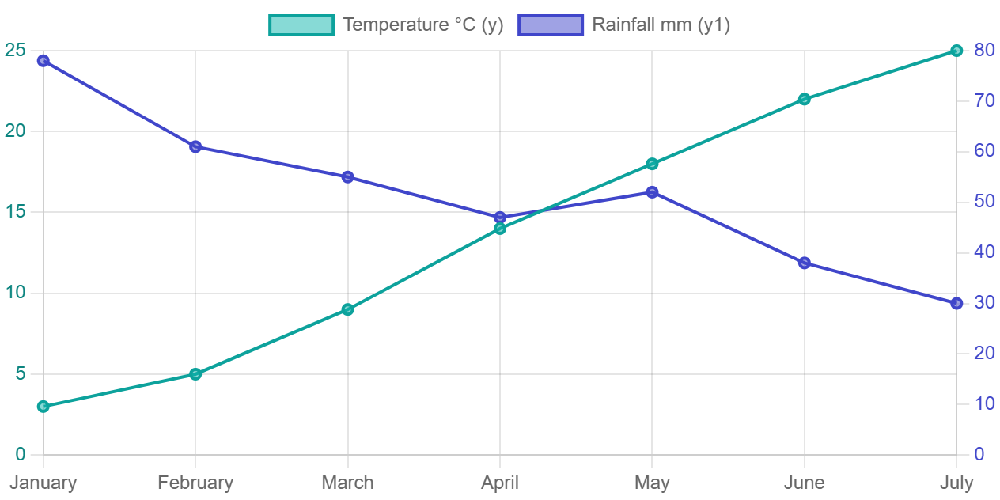

[Open the sample](https://chartjs.blazorexpress.com/demos/line-chart/multiple-axes)

More components coming...

## Creators

**Vikram Reddy**

## Copyright and license

Code and documentation copyright 2026 [Blazor Express](https://blazorexpress.com/) Code released under the [Apache-2.0 License](https://github.com/BlazorExpress/BlazorExpress.ChartJS/blob/main/LICENSE).
