# BlazorExpress.ChartJS component library

### An open-source, production-ready Blazor charts component library built on the Blazor and Chart.js JavaScript library.

## Table of contents

- [Quick start](#quick-start)
- [Online Demos](#online-demos)
- [Supported Tech Stack](#supported-tech-stack)
- [Components](#components)
- [Screenshots](#screenshots)
- [Creators](#creators)
- [Copyright and license](#copyright-and-license)

## Quick start

Get started any way you want

- Clone the repo: `git clone https://github.com/BlazorExpress/BlazorExpress.ChartJS`
- Install with the .NET CLI: `dotnet add package BlazorExpress.ChartJS --version 2.0.0`
- Or with the [NuGet](https://www.nuget.org/) Package Manager Console: `Install-Package BlazorExpress.ChartJS -Version 2.0.0`
- Upgrading from 1.x? 2.0.0 changes some defaults and behaviour, so read the [2.0.0 release notes](https://github.com/BlazorExpress/BlazorExpress.ChartJS/blob/main/CHANGELOG.md#200) first.

## Online Demos

- [Demos Website](https://chartjs.blazorexpress.com)

## Supported Tech Stack

| BlazorExpress.ChartJS | .NET | Chart.js | chartjs-plugin-datalabels |
|:--|:--|:--|:--|
| 2.0.0+ | 8, 9, 10, 11 | 4.6.1 | 2.2.0 |
| 1.2.2+ | 8, 9, 10 | 4.4.1 | 2.2.0 |
| 1.1.0+ | 8 | 4.4.1 | 2.2.0 |
| 1.0.0 | 8 | 4.0.1 | 2.2.0 |

## Components

| Component Name | Demos | Docs |
|:--|:--|:--|
| Charts: Bar chart | [Demos](https://chartjs.blazorexpress.com/demos/bar-chart) | [Docs](https://chartjs.blazorexpress.com/docs/bar-chart) |
| Charts: Bubble chart | [Demos](https://chartjs.blazorexpress.com/demos/bubble-chart) | [Docs](https://chartjs.blazorexpress.com/docs/bubble-chart) |
| Charts: Doughnut chart | [Demos](https://chartjs.blazorexpress.com/demos/doughnut-chart) | [Docs](https://chartjs.blazorexpress.com/docs/doughnut-chart) |
| Charts: Line chart | [Demos](https://chartjs.blazorexpress.com/demos/line-chart) | [Docs](https://chartjs.blazorexpress.com/docs/line-chart) |
| Charts: Pie chart | [Demos](https://chartjs.blazorexpress.com/demos/pie-chart) | [Docs](https://chartjs.blazorexpress.com/docs/pie-chart) |
| Charts: PolarArea chart | [Demos](https://chartjs.blazorexpress.com/demos/polar-area-chart) | [Docs](https://chartjs.blazorexpress.com/docs/polar-area-chart) |
| Charts: Radar chart | [Demos](https://chartjs.blazorexpress.com/demos/radar-chart) | [Docs](https://chartjs.blazorexpress.com/docs/radar-chart) |
| Charts: Scatter chart | [Demos](https://chartjs.blazorexpress.com/demos/scatter-chart) | [Docs](https://chartjs.blazorexpress.com/docs/scatter-chart) |

## Screenshots

Captured from the [online demos](https://chartjs.blazorexpress.com/demos/samples).

### Chart types

#### Bar chart

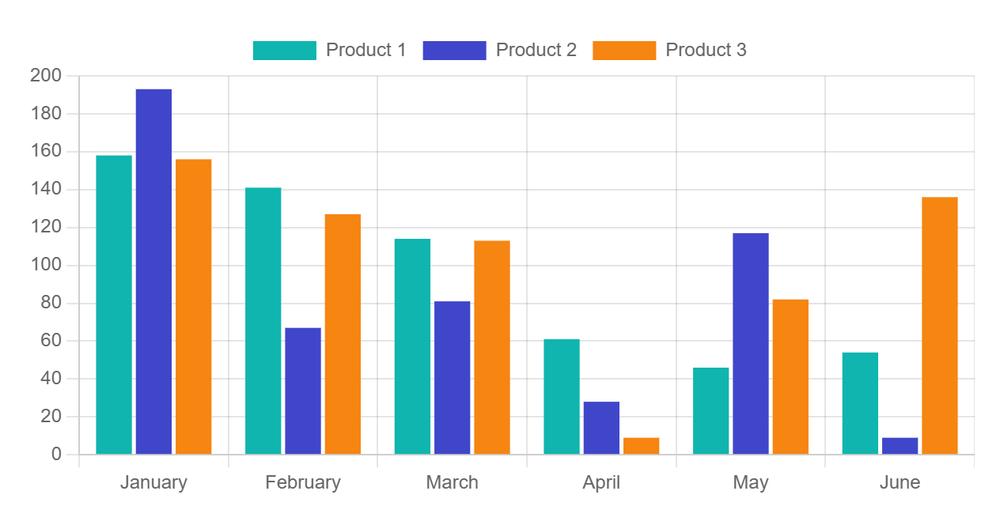

#### Bubble chart

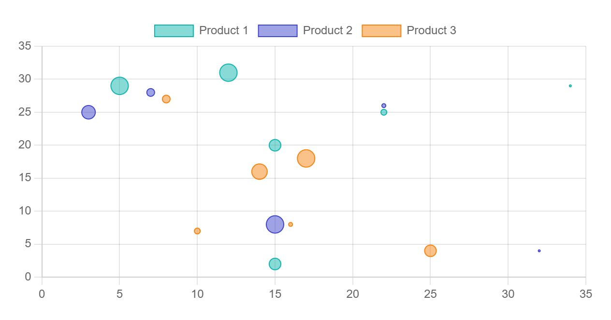

#### Doughnut chart

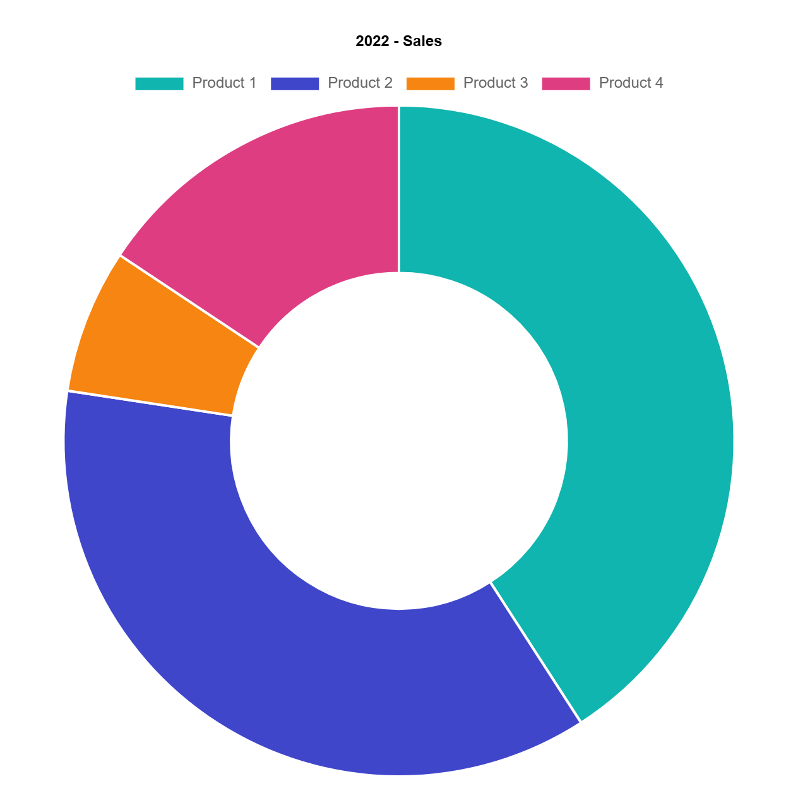

#### Line chart

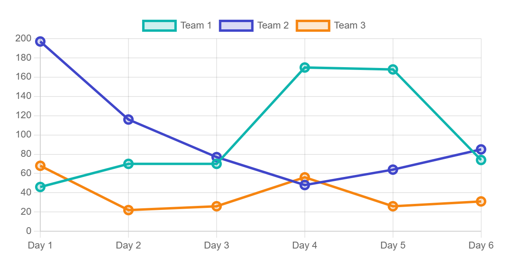

#### Pie chart

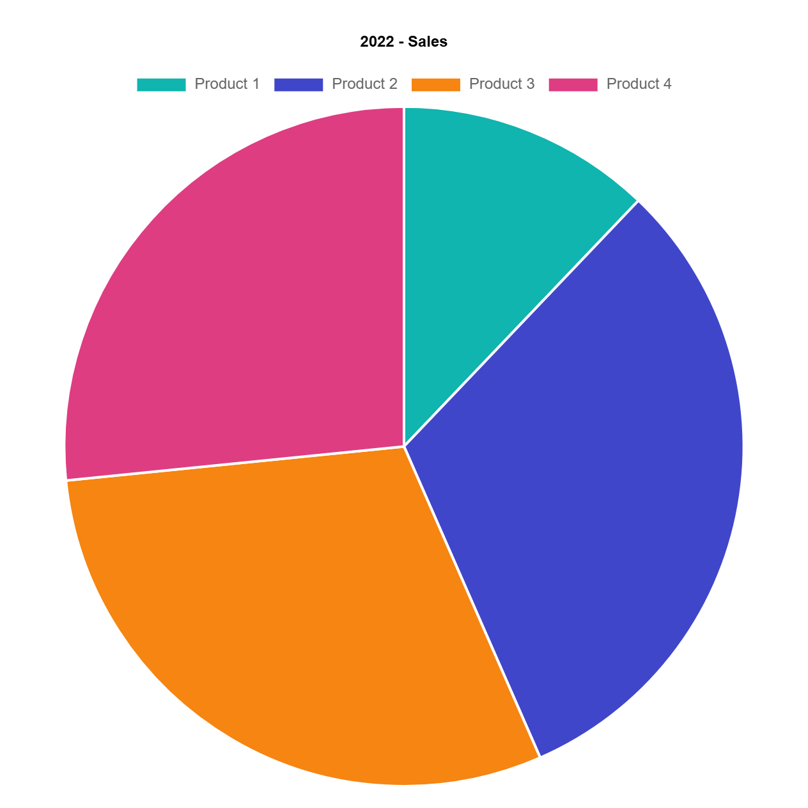

#### PolarArea chart

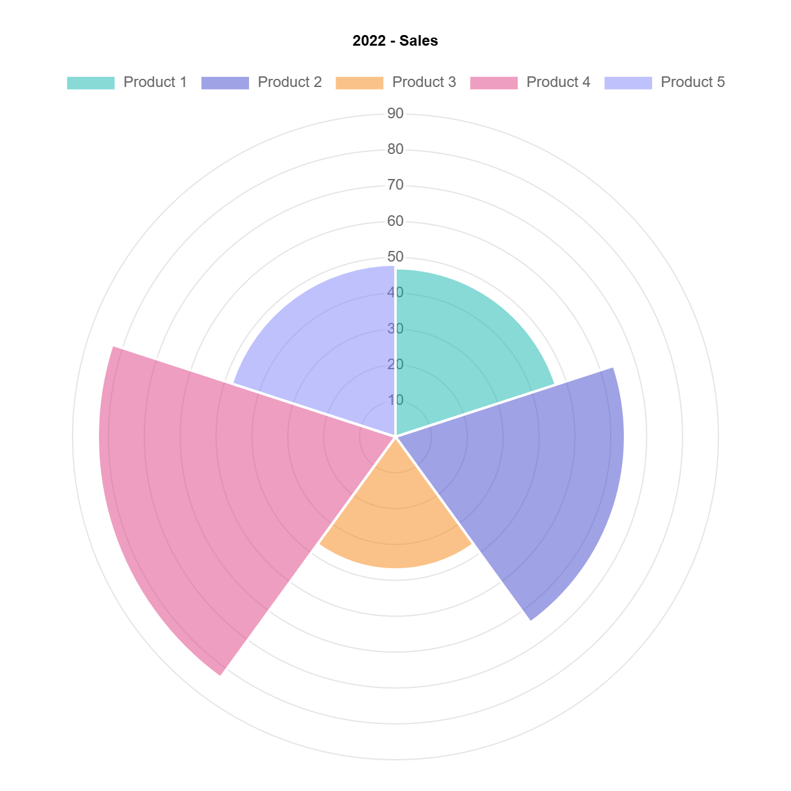

#### Radar chart

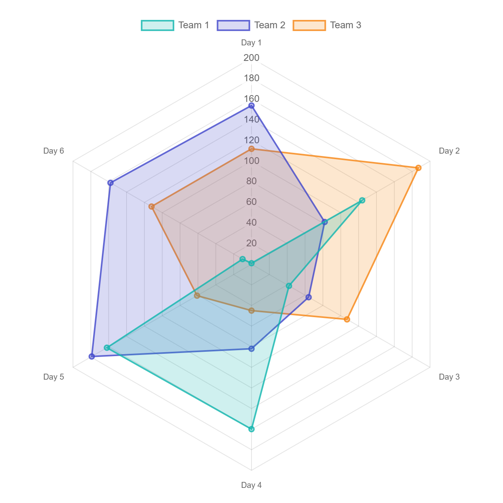

#### Scatter chart

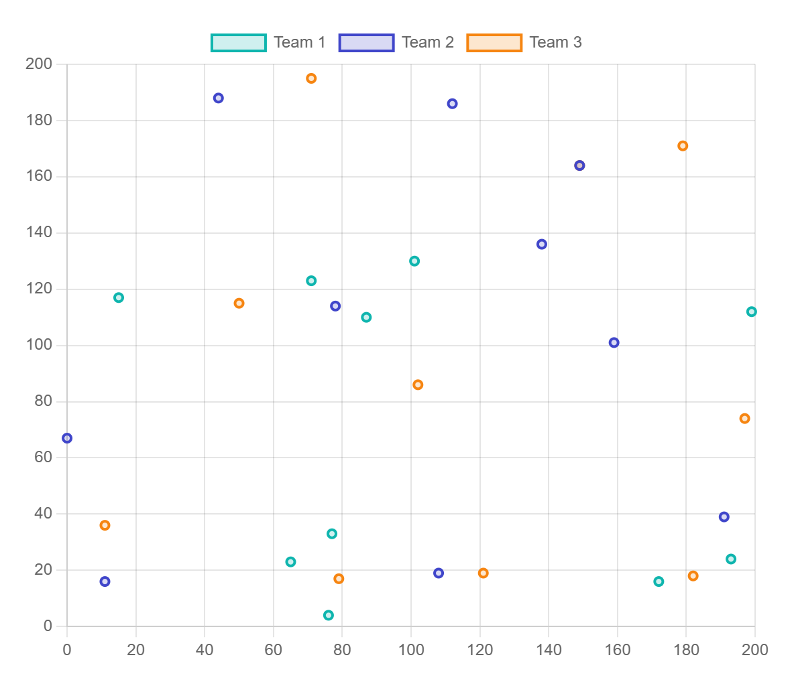

### New in 2.0.0

#### Time series

Line chart on a `timeseries` axis with dates from C#; no date adapter script needed.

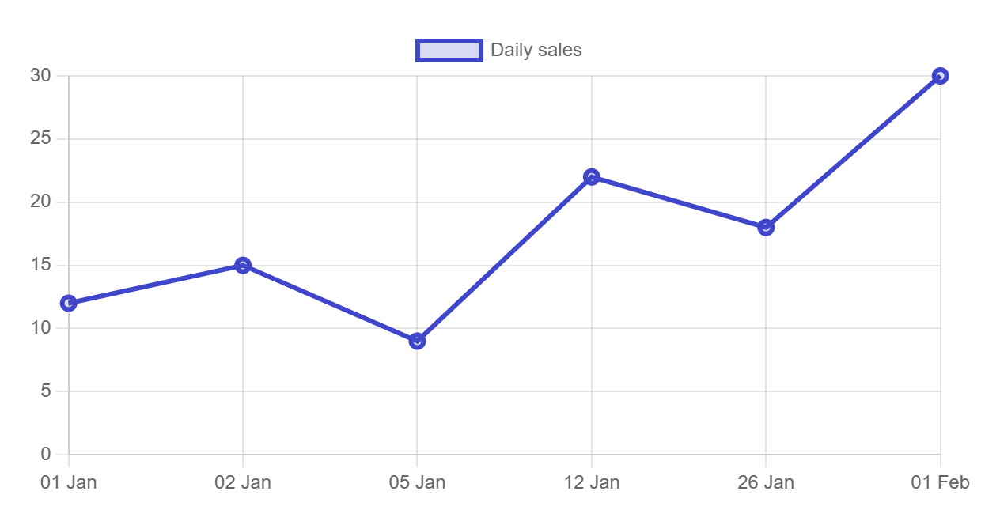

#### Tick and tooltip functions

Axis ticks and tooltip text formatted by JavaScript functions registered by name and set from C#.

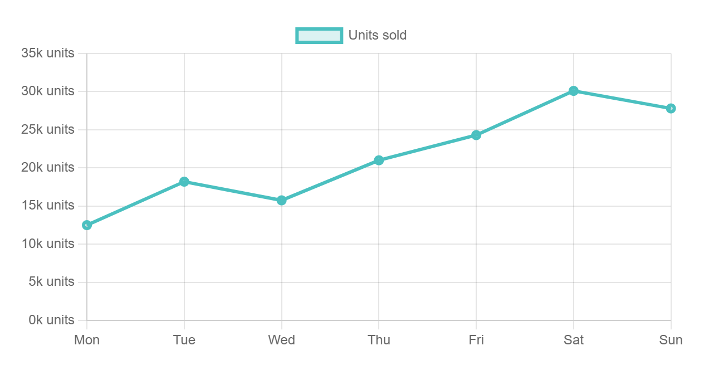

#### Floating bars

A project schedule drawn with floating bars, each with a start and an end value (`BarChartDataset.FloatingData`).

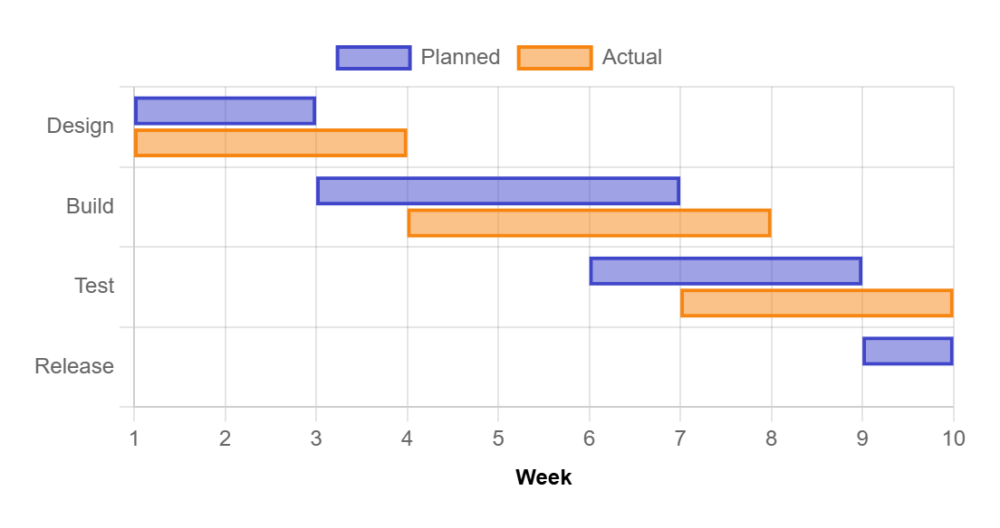

#### Half gauge

A half-doughnut gauge from `Rotation` and `Circumference`.

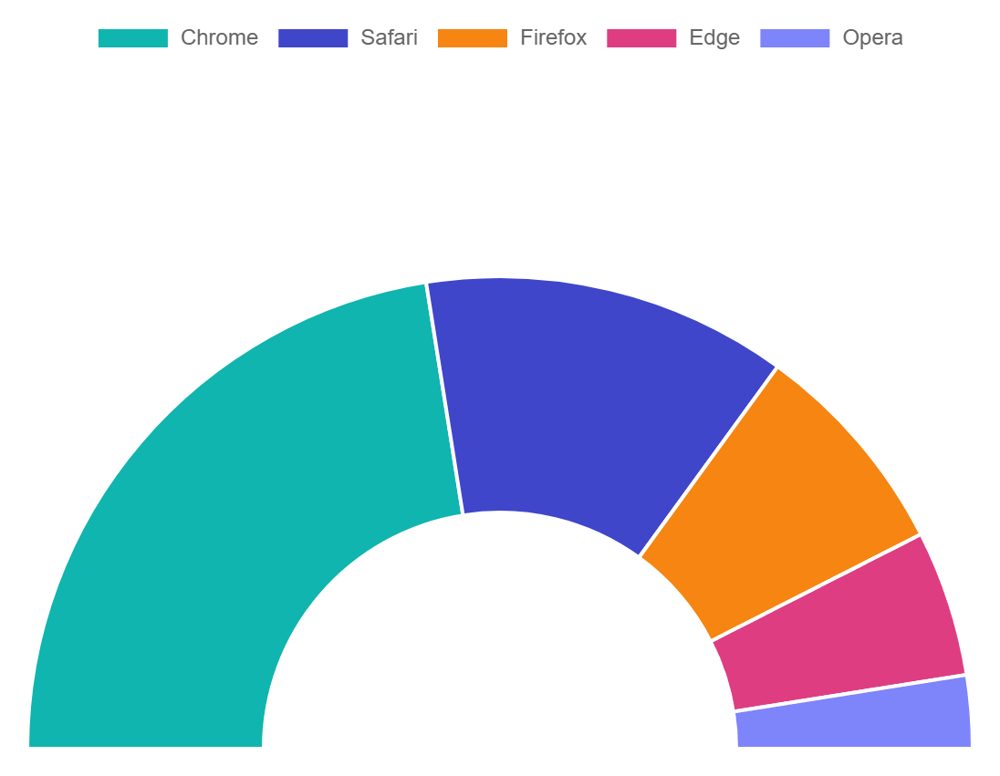

#### Gradient fill

A line area filled with a gradient set by a JavaScript function.

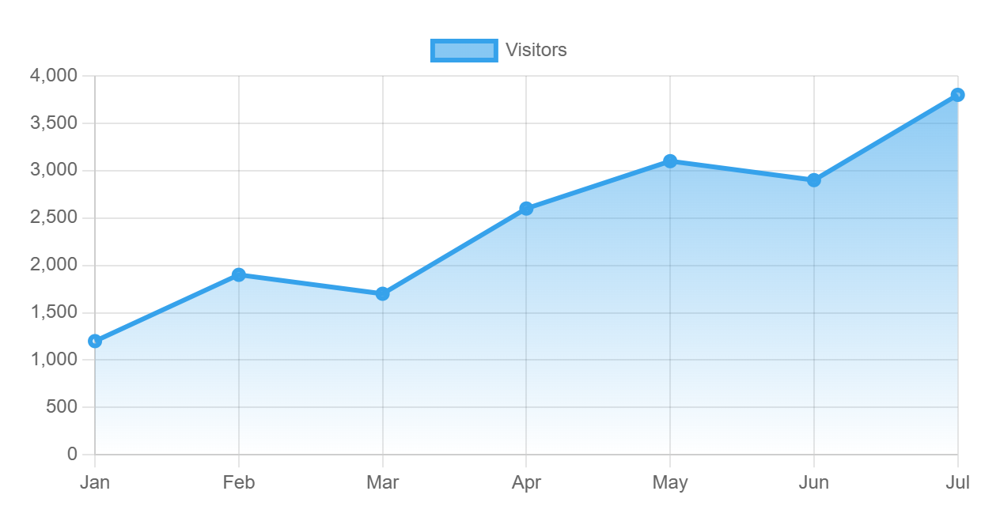

#### Multiple axes

A second y axis on the right (`Scales.AdditionalAxes`).

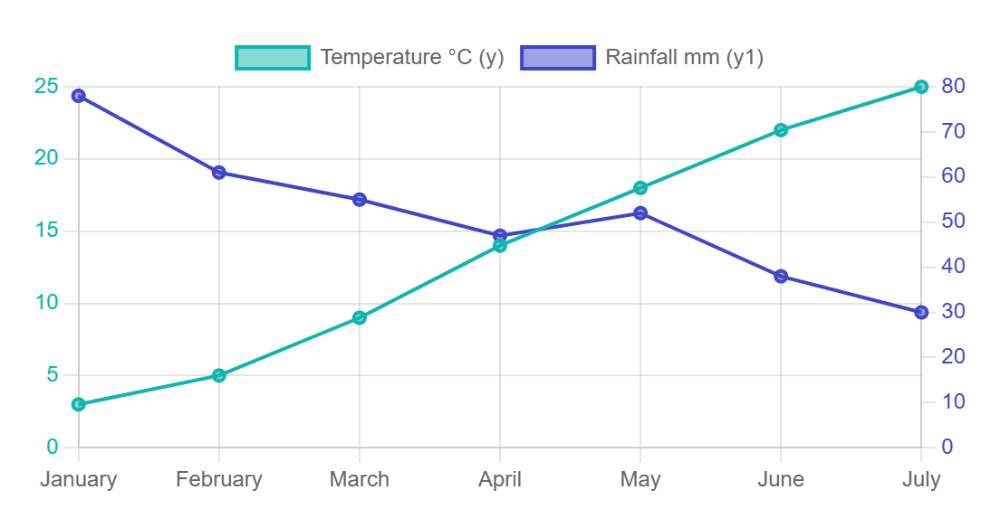

More components coming...

## Creators

**Vikram Reddy**

## Copyright and license

Code and documentation copyright 2026 [Blazor Express](https://blazorexpress.com/) Code released under the [Apache-2.0 License](https://github.com/BlazorExpress/BlazorExpress.ChartJS/blob/main/LICENSE).
